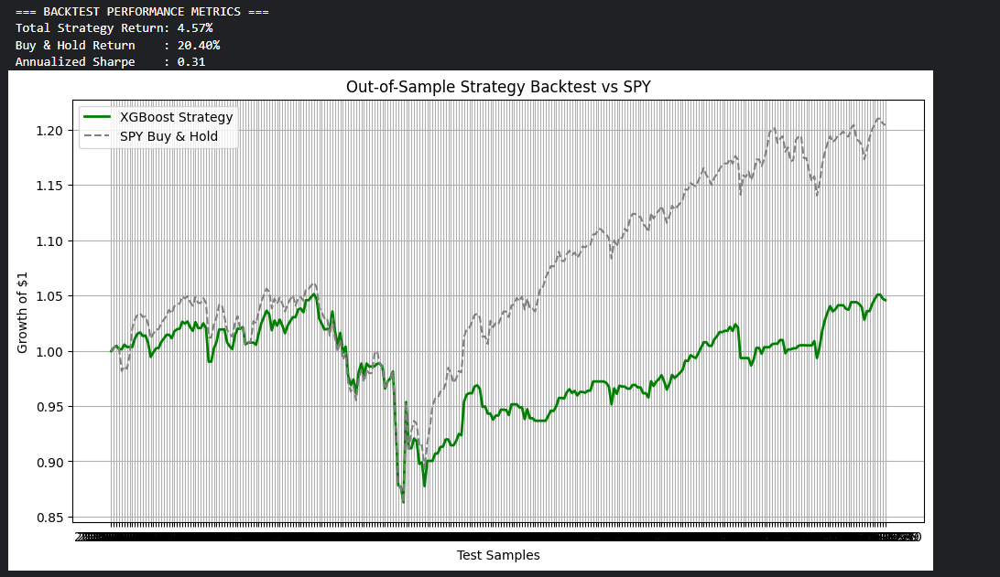
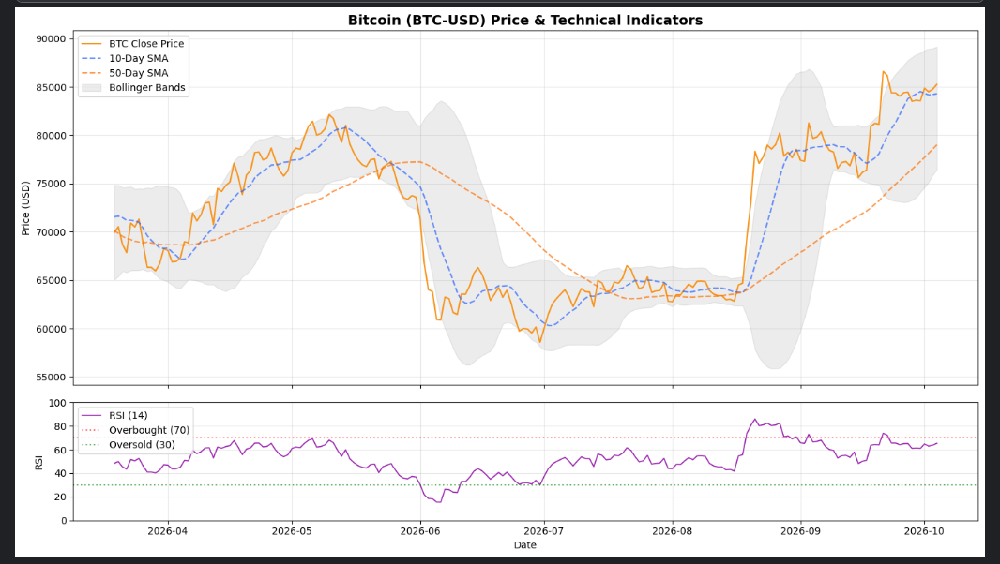
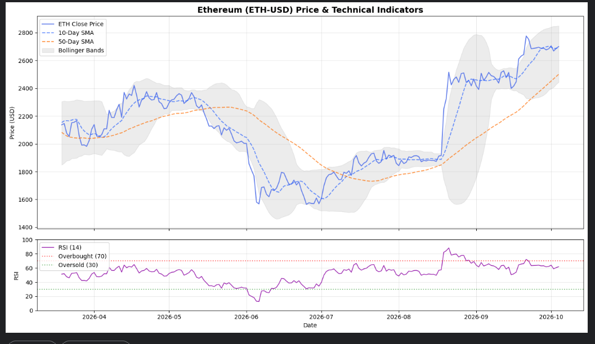

# Multi-Asset AI Trading Bot

<p align="center">
	
	
	
	
</p>

A Python research and paper-trading system for SPY, Bitcoin, and Ethereum. It engineers shared market features, trains per-asset XGBoost regressors to estimate three-day forward returns, validates candidates on chronological holdouts, and connects eligible signals to an Alpaca **paper-trading** account.

## ⚠️ Disclaimer: please read before using

**This project is a learning and research prototype. It is not a finished trading product, it is not proven to make money, and it is not financial advice.**

- **It has not demonstrated a reliable edge.** In this repository's own backtests the strategy trailed buy-and-hold on SPY and ETH, and its Bitcoin results were mixed and weaker in recent years. Past or simulated performance does not predict future results.
- **It runs on paper trading by default.** A live-trading mode exists only behind deliberate safeguards (see [Live-Trading Safeguards](#live-trading-safeguards)) so the code can be tested. It is not a recommendation to trade real money with this bot.
- **You can lose money, including all of it.** Markets, and crypto in particular, are volatile. Fees, slippage, bugs, bad or delayed data (this project relies on Yahoo Finance via `yfinance`), broker or network outages and scheduler delays on GitHub Actions can all cause losses that a backtest does not show. Only ever risk money you can afford to lose.
- **No warranty and no liability.** The software is provided "as is" under the [MIT License](LICENSE). The authors and contributors are not responsible for any loss or damage arising from its use.
- **You are responsible for your own decisions.** Follow the laws, tax rules and broker terms that apply to you. Nothing here is investment, legal or tax advice.
- **No affiliation.** This project is independent and is not affiliated with or endorsed by Alpaca, Yahoo, Telegram or any other service it connects to.

## Backtest Snapshot

The chart below is the Kaggle backtest output included with the project.



| Reported metric | Result |
| --- | ---: |
| Strategy total return | 4.57% |
| SPY buy-and-hold return | 20.40% |
| Annualized Sharpe ratio | 0.31 |

These figures are transcribed from the supplied output image. In that run, the strategy returned less than buy-and-hold; this result should be evaluated with additional validation, costs, and risk measures before drawing conclusions.

## Workflow

1. **Engineer features:** `features/pipeline.py` normalizes daily OHLCV data and calculates the shared regression and legacy feature contracts.
2. **Retrain:** `python retrain.py` downloads SPY, BTC-USD, and ETH-USD, selects a prediction cutoff using a training-only chronological validation slice, evaluates untouched holdouts, and exports each asset immediately when it passes Path A or Path B.
3. **Execute:** `python run_execution.py` evaluates all configured assets in Alpaca paper mode. Use `python run_execution.py --symbol BTC-USD` to run only one asset.
4. **Notify:** Telegram BUY, cleanup, and retraining reports are sent when `TELEGRAM_BOT_TOKEN` and `TELEGRAM_CHAT_ID` are configured. Notification failures do not interrupt trading or retraining.
5. **Daily Digest:** `python daily_digest.py` generates a Monday-Saturday market snapshot with 24h crypto stats, portfolio status, and current model signals. Requires `TELEGRAM_INSIGHTS_BOT_TOKEN` and `TELEGRAM_INSIGHTS_CHAT_ID`.
6. **Weekly Insights:** `python weekly_insights.py` generates a Sunday newsletter with 7-day performance analysis, trading metrics, and model summaries. Requires `TELEGRAM_INSIGHTS_BOT_TOKEN` and `TELEGRAM_INSIGHTS_CHAT_ID`.

## Project Files

| Path | Purpose |
| --- | --- |
| `config.py` | Asset definitions, artifact paths, feature references, model settings, and environment variable names. |
| `features/contract.py` | Current five-feature regression schema and legacy classifier schemas. |
| `features/pipeline.py` | Shared OHLCV normalization, regression feature engineering, and legacy dataset generation. |
| `models/base_model.py` | Common fit, signal, and artifact interface. |
| `models/regressor.py` | Three-day return regressor and persisted per-model decision threshold. |
| `models/classifier.py` | Compatibility wrapper for legacy classifier artifacts. |
| `retrain.py` | Per-asset training, holdout gates, percentile cutoff selection, and Telegram report. |
| `run_execution.py` | Symbol-scoped Alpaca paper execution and Telegram trade/cleanup reports. |
| `telegram_notifier.py` | Best-effort Telegram Bot API helper using `urllib`. Supports dual-bot routing with explicit token parameters. |
| `daily_digest.py` | Generates Monday-Saturday market snapshots with 24h crypto stats, portfolio status, and model signals. |
| `weekly_insights.py` | Generates Sunday newsletter with 7-day performance analysis, trading metrics, and model summaries. |
| `fetch_data.py`, `prepare_dataset.py` | Legacy SPY one-day CSV preparation through the shared feature pipeline. |
| `Model/*.json` | Native XGBoost model artifacts, updated per asset when its gate passes. |
| `Output_model/` | Archived Kaggle charts and evaluation outputs. |
| `.github/workflows/retrain_models.yml` | Automated weekly model retraining on Sundays with graceful failure handling. |
| `.github/workflows/daily_digest.yml` | Scheduled daily digest Monday-Saturday at 08:00 UTC. |
| `.github/workflows/weekly_insights.yml` | Scheduled weekly insights newsletter on Sundays at 18:00 UTC. |

## Features and Target

The current regression contract uses the same five ordered inputs for each asset: `SMA_20_50_Ratio`, `ATR_Normalized`, `RSI_14`, `ROC_5`, and `SPY_ROC_5`. The shared pipeline computes the benchmark feature from SPY closes and uses each asset's own OHLCV for the remaining indicators.

The model target is the three-day forward return, `(Close[t+3] - Close[t]) / Close[t]`. Holdout direction is positive when that return exceeds `0.5%`; predicted returns are converted to signals using the cutoff stored in each model's JSON attributes. Rolling-window rows and the final three unlabeled rows are excluded from training.

Legacy classifier artifacts remain loadable with their historical feature contracts until replaced by a passing regressor artifact.

## Tools

- **Python**, **pandas** — data preparation and tabular features
- **yfinance** — historical and recent market data
- **ta** — technical indicators
- **XGBoost**, **scikit-learn** — regression/classification models and native JSON serialization
- **Telegram Bot API** — optional HTML notifications
- **Alpaca Trading API** (`alpaca-py`) — paper account and order submission
- **python-dotenv** — local API credential loading

## Setup

Use Python 3.10 or newer. From the project folder, create and activate a virtual environment, then install the packages listed in `requirements.txt`:

```powershell
python -m venv venv
.\venv\Scripts\Activate.ps1
python -m pip install -r requirements.txt
```

Create a `.env` file in the project root with Alpaca **paper** credentials:

```dotenv
ALPACA_API_KEY=your_paper_api_key
ALPACA_SECRET_KEY=your_paper_secret_key
TELEGRAM_BOT_TOKEN=your_telegram_bot_token
TELEGRAM_CHAT_ID=your_telegram_chat_id
TELEGRAM_INSIGHTS_BOT_TOKEN=your_insights_bot_token
TELEGRAM_INSIGHTS_CHAT_ID=your_insights_chat_id
```

Keep `.env` private and do not commit credentials. Store the same variable names as GitHub Actions secrets for scheduled runs. The execution client is initialized with `paper=True`. The insights bot credentials are used for daily digest and weekly insights notifications.

## Run

Run per-asset chronological retraining and holdout evaluation:

```powershell
python retrain.py
```

Each artifact is updated immediately when that asset passes either gate: Path A requires accuracy more than 1.5 percentage points above its holdout majority baseline and ROC-AUC above 0.52; Path B requires ROC-AUC at least 0.54 and accuracy no worse than 2 points below the baseline. A failed asset retains its existing artifact. The command returns nonzero if any asset fails or cannot be evaluated.

Run paper execution for all assets or select one:

```powershell
python run_execution.py
python run_execution.py --symbol BTC-USD
```

Regressor BUY signals use the artifact's persisted return cutoff. Crypto orders use USD notional; SPY orders use whole shares and ATR-based bracket exits. Legacy classifiers continue through the compatibility wrapper. Live prices are estimates and fills may differ because of market movement and slippage.

On a HOLD signal, execution cancels pending symbol orders and closes any open position. Telegram notifications are best effort and never block order handling. Review account settings and signals before running; execution uses Alpaca paper mode.

Generate daily market digest (Monday-Saturday):

```powershell
python daily_digest.py
```

This script fetches 24h stats for BTC-USD and ETH-USD, queries Alpaca for portfolio status, and reports current model signals to the insights bot.

Generate weekly insights newsletter (Sunday):

```powershell
python weekly_insights.py
```

This script calculates 7-day performance metrics, analyzes trading history, and summarizes model performance in a detailed newsletter.

## GitHub Actions Automation

The repository includes three scheduled workflows for automated operation:

| Workflow | Schedule | Purpose |
| --- | --- | --- |
| `retrain_models.yml` | Sundays at 00:00 UTC | Automated model retraining with graceful failure handling. Commits updated model artifacts even if some assets fail gates. |
| `daily_digest.yml` | Monday-Saturday at 08:00 UTC | Sends daily market snapshots with crypto stats, portfolio status, and model signals. |
| `weekly_insights.yml` | Sundays at 18:00 UTC | Sends weekly newsletter with 7-day analysis, trading metrics, and model summaries. |

All workflows support manual triggering via `workflow_dispatch` and require the following GitHub Actions secrets:
- `ALPACA_API_KEY`
- `ALPACA_SECRET_KEY`
- `TELEGRAM_BOT_TOKEN` (for retraining notifications)
- `TELEGRAM_CHAT_ID` (for retraining notifications)
- `TELEGRAM_INSIGHTS_BOT_TOKEN` (for digest and insights)
- `TELEGRAM_INSIGHTS_CHAT_ID` (for digest and insights)

## Walk-Forward Backtest

`python backtest.py` compares the live entry/exit rule against buy-and-hold over the same window. Models are retrained on an expanding window and only predict later bars, the decision threshold is calibrated on training data, signals fill at the next bar's open, and every position change pays fees plus slippage. Output goes to `backtest_results/` (git-ignored): `summary.csv` and one equity curve per asset.

```powershell
python backtest.py
python backtest.py --start 2020-01-01 --slippage-bps 10 --assets BTC-USD ETH-USD
```

It also reports a buy-and-hold scaled to the strategy's time in the market, which is the fairer comparison when the strategy is often in cash. The backtest is fully invested when long and does not simulate ATR sizing, the stop-loss, cooldown or minimum-hold rules, so live results will differ. Results are historical and not a prediction.

## Live-Trading Safeguards

The bot trades on paper by default. Going live is deliberately hard: `run_execution.py` refuses to start unless **all three** are set.

| Variable | Required value |
| --- | --- |
| `ALPACA_PAPER` | `false` |
| `ALPACA_LIVE_CONFIRM` | `I_ACCEPT_REAL_MONEY_RISK` |
| `ALPACA_LIVE_MAX_CAPITAL` | A positive dollar amount. All sizing treats the account as holding at most this much, counting positions already open. |

Two controls stop **new entries** while still allowing exits, stop-losses and HOLD cleanups:

- **Kill switch:** set `TRADING_HALTED=true`, or create an empty file named `HALT_TRADING` in the project root. On GitHub Actions only the variable works (each run starts from a fresh checkout): add a repository variable named `TRADING_HALTED` with value `true` under *Settings > Secrets and variables > Actions > Variables*, and delete it or set it to `false` to resume.
- **Daily-loss circuit breaker:** entries stop when equity is down 3% or more versus the previous close. Override with `MAX_DAILY_LOSS_PCT` (for example `0.02`).

A halt is also sent to Telegram. Run the tests with `python -m unittest discover -s tests -v`.

## Frequent Stop-Loss Check

Alpaca has no bracket orders for crypto, so the crypto stop-loss is enforced by the bot, and the full trading run only happens every couple of hours. `python run_execution.py --risk-only` is a lightweight mode for running much more often: it only checks open crypto positions against their ATR stop and closes any that fell through it. It loads no model, creates no signals and never opens a position. With no open position it fetches no market data. It does not need the live-mode confirmation, so a misconfigured setup can never leave a position unchecked.

The `risk_check.yml` workflow runs it. It has no schedule of its own: point a second cron-job.org job at its `workflow_dispatch` every 10-15 minutes, the same way as the trading workflow. It shares the trading workflow's concurrency lock so the two never place orders at once, and it sends a Telegram alert if the check itself fails. Each run installs dependencies, so on a private repository check your monthly Actions minutes before choosing a very short interval.

## Limitations

- Historical Kaggle training notebooks and charts are archival; current models are trained by `retrain.py`.
- Model quality gates can fail because market returns are noisy. In that case the previous model remains active for that asset.
- Reported backtest performance is limited to the supplied screenshot; fees, slippage, and other risk statistics are not documented in the repository.
- Regression outputs and percentile cutoffs are not guarantees of future returns.

## License and Security

Released under the [MIT License](LICENSE). To report a security problem, see [SECURITY.md](SECURITY.md) and please do not open a public issue for it.

## Kaggle Model Prediction Curves

The following charts were generated in the Kaggle notebook on **October 4, 2026**.

### SPY


### Bitcoin (BTC)



### Ethereum (ETH)


