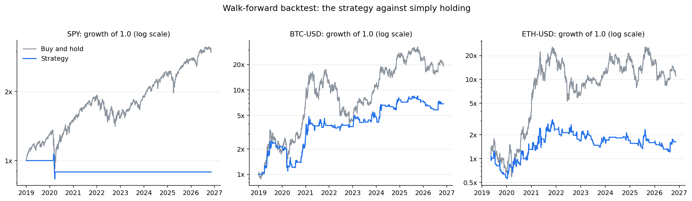
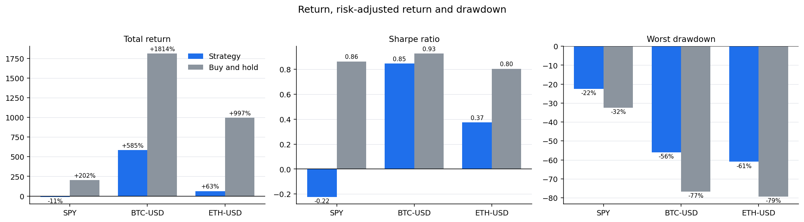
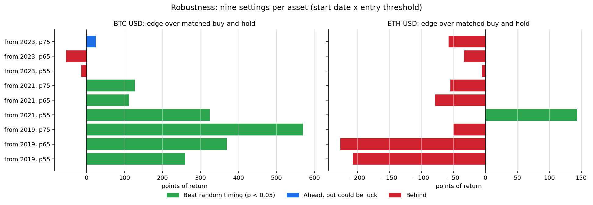
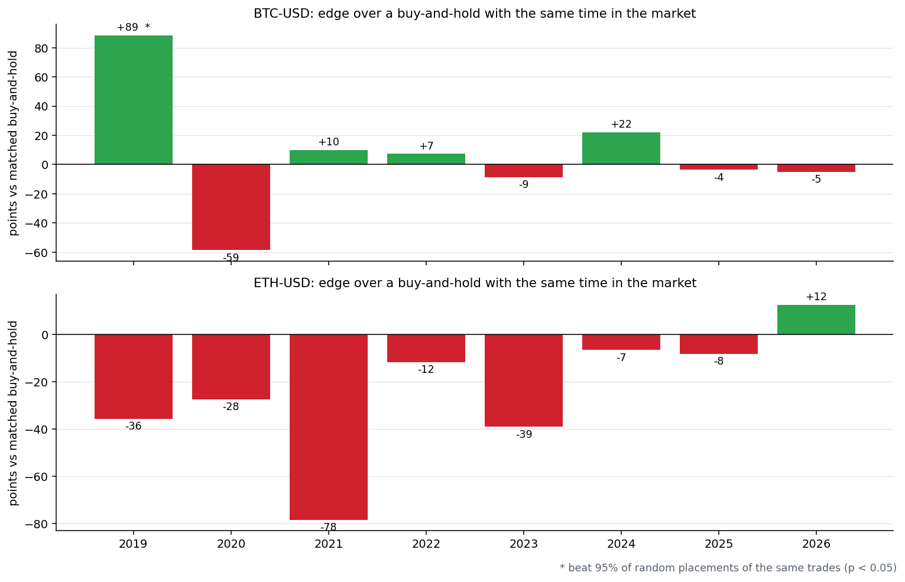

# Multi-Asset AI Trading Bot

<p align="center">
	
	
	
	
</p>

A Python research and paper-trading system for SPY, Bitcoin, and Ethereum. It engineers shared market features, trains per-asset XGBoost regressors to estimate three-day forward returns, validates candidates on chronological holdouts, and connects eligible signals to an Alpaca **paper-trading** account.

## ⚠️ Disclaimer: please read before using

**This project is a learning and research prototype. It is not a finished trading product, it is not proven to make money, and it is not financial advice.**

- **It has not demonstrated a reliable edge.** In this repository's own backtests the strategy trailed buy-and-hold on SPY and ETH, and its Bitcoin results were mixed and weaker in recent years. Past or simulated performance does not predict future results.
- **It runs on paper trading by default.** A live-trading mode exists only behind deliberate safeguards (see [Live-Trading Safeguards](#live-trading-safeguards)) so the code can be tested. It is not a recommendation to trade real money with this bot.
- **You can lose money, including all of it.** Markets, and crypto in particular, are volatile. Fees, slippage, bugs, bad or delayed data (this project relies on Yahoo Finance via `yfinance`), broker or network outages and scheduler delays on GitHub Actions can all cause losses that a backtest does not show. Only ever risk money you can afford to lose.
- **No warranty and no liability.** The software is provided "as is" under the [MIT License](LICENSE). The authors and contributors are not responsible for any loss or damage arising from its use.
- **You are responsible for your own decisions.** Follow the laws, tax rules and broker terms that apply to you. Nothing here is investment, legal or tax advice.
- **No affiliation.** This project is independent and is not affiliated with or endorsed by Alpaca, Yahoo, Telegram or any other service it connects to.

## Where the Project Stands

**In one sentence:** the engineering is finished and tested, but the backtests do not show a dependable edge, so the bot stays on paper trading while it collects real evidence.

### What has been built

| Area | State |
| --- | --- |
| Model and retraining | Per-asset XGBoost three-day return models for SPY, BTC-USD and ETH-USD, promoted only when they pass accuracy, walk-forward, net-of-cost and forward-test gates. |
| Execution | Alpaca paper trading with ATR position sizing, a 25% position cap, cooldowns and a software stop-loss for crypto. |
| Safety | Live trading needs three deliberate settings; kill switch (`TRADING_HALTED` or `HALT_TRADING`); 3% daily-loss circuit breaker; per-asset buying switch (only BTC-USD may buy); halts block new entries only and never block exits. |
| Monitoring | A 15-minute stop-loss check (`--risk-only`) and an hourly watchdog that sends a Telegram alert if scheduled runs stop. |
| Research | Walk-forward backtest with fees and slippage, robustness grid, random-timing test, and a year-by-year breakdown (below). |
| Code health | Large scripts split into `execution/` and `training/` packages, related tools grouped into folders, 212 tests, and every dependency pinned to a tested version. |

### What the research found

All figures come from one walk-forward run (models retrained on an expanding window, next-bar-open fills, a 0.5% round-trip fee on crypto plus 5 bps slippage per side) from 2019 to November 2026. The run is fully invested when long and ignores sizing, the stop-loss and cooldowns, so live results will differ.



| Asset | Strategy return | Buy-and-hold | Time in market | Sharpe (strategy / hold) | Worst drawdown (strategy / hold) |
| --- | ---: | ---: | ---: | ---: | ---: |
| SPY | -11% | +202% | 1% (3 trades) | -0.22 / 0.86 | -22% / -32% |
| BTC-USD | +585% | +1,814% | 29% (156 trades) | 0.85 / 0.93 | -56% / -77% |
| ETH-USD | +63% | +997% | 34% (130 trades) | 0.37 / 0.80 | -61% / -79% |



Beating buy-and-hold is not the right test for a strategy that sits in cash most of the time. A fairer test compares it with a buy-and-hold that is invested for the same share of days, and then asks whether the same trades placed at random times would have done as well.





**What this means**

- **SPY:** the model almost never trades (three trades, 1% of the time in the market), so there is nothing to evaluate. It stays disabled for buying.
- **ETH-USD:** no edge. It trailed the matched benchmark in 6 of 8 years and in 8 of 9 robustness settings, and the single setting that beat random timing does not hold up in the others. It stays disabled for buying.
- **BTC-USD:** mixed, and weaker than a first look suggests. The strategy had less risk than holding (a smaller drawdown), but it beat the matched benchmark in only 4 of 8 years. One year, 2019 (+89 points), carries most of the headline edge and is the only year that beats random timing. From 2023 onward the edge is small (+18 points, p = 0.09) and the last two years are slightly negative. BTC is the only asset allowed to buy, and only on paper.
- **Costs matter:** doubling slippage from 5 to 10 bps cuts the BTC result from +585% to +486%, and 20 bps cuts it to +328%.

**Decision:** keep BTC on paper for two to three months. That live record, not the backtest, is the evidence that decides whether real money is ever worth considering.

To regenerate the charts after rerunning the research scripts, install matplotlib (`pip install matplotlib`, used only for charts) and run `python -m research.charts`.

### What comes next

1. Let the paper trial run and compare live fills, stop-outs and returns with the backtest.
2. Review the results after two to four weeks, then monthly.
3. Only if the paper results hold up, decide whether to add an exchange-side resting stop (Alpaca supports stop-limit orders for crypto, with gap and cancel-ordering risks) before any small live test.

## Original Kaggle Backtest

The chart below is the Kaggle backtest output the project started from. It predates the walk-forward research above, which supersedes it.


| Reported metric | Result |
| --- | ---: |
| Strategy total return | 4.57% |
| SPY buy-and-hold return | 20.40% |
| Annualized Sharpe ratio | 0.31 |

These figures are transcribed from the supplied output image. In that run, the strategy returned less than buy-and-hold; this result should be evaluated with additional validation, costs, and risk measures before drawing conclusions.

## Workflow

1. **Engineer features:** `features/pipeline.py` normalizes daily OHLCV data and calculates the shared regression and legacy feature contracts.
2. **Retrain:** `python retrain.py` downloads SPY, BTC-USD, and ETH-USD, selects a prediction cutoff using a training-only chronological validation slice, evaluates untouched holdouts, and exports each asset immediately when it passes Path A or Path B.
3. **Execute:** `python run_execution.py` evaluates all configured assets in Alpaca paper mode. Use `python run_execution.py --symbol BTC-USD` to run only one asset.
4. **Notify:** Telegram BUY, cleanup, and retraining reports are sent when `TELEGRAM_BOT_TOKEN` and `TELEGRAM_CHAT_ID` are configured. Notification failures do not interrupt trading or retraining.
5. **Daily Digest:** `python -m reporting.daily_digest` generates a Monday-Saturday market snapshot with 24h crypto stats, portfolio status, and current model signals. Requires `TELEGRAM_INSIGHTS_BOT_TOKEN` and `TELEGRAM_INSIGHTS_CHAT_ID`.
6. **Weekly Insights:** `python -m reporting.weekly_insights` generates a Sunday newsletter with 7-day performance analysis, trading metrics, and model summaries. Requires `TELEGRAM_INSIGHTS_BOT_TOKEN` and `TELEGRAM_INSIGHTS_CHAT_ID`.

## Project Files

| Path | Purpose |
| --- | --- |
| `config.py` | Asset definitions, artifact paths, feature references, model settings, and environment variable names. |
| `features/contract.py` | Current five-feature regression schema and legacy classifier schemas. |
| `features/pipeline.py` | Shared OHLCV normalization, regression feature engineering, and legacy dataset generation. |
| `models/base_model.py` | Common fit, signal, and artifact interface. |
| `models/regressor.py` | Three-day return regressor and persisted per-model decision threshold. |
| `models/classifier.py` | Compatibility wrapper for legacy classifier artifacts. |
| `retrain.py` | Command-line entry point for retraining: runs every asset through the gates and records the buy/block status. |
| `training/` | The retraining logic, one module per job: `settings` (thresholds and switches), `data`, `gates` (quality gate, strategy simulation, walk-forward check), `threshold`, `candidate` (train and validate a new model), `incumbent` (score the live model and the classifier challenger), `status` (the buy/block decision and `model_status.json`) and `report` (Telegram). |
| `run_execution.py` | Command-line entry point for Alpaca execution: argument parsing and the per-asset loop. |
| `execution/` | The execution logic, one module per job: `mode`, `broker`, `market_data`, `safeguards`, `risk` (stop-loss and `--risk-only`), `gates` (entry checks), `sizing`, `orders` and `trading` (the per-asset flow). |
| `notifications/telegram.py` | Best-effort Telegram Bot API helper using `urllib`. Supports dual-bot routing with explicit token parameters. |
| `reporting/daily_digest.py` | Generates Monday-Saturday market snapshots with 24h crypto stats, portfolio status, and model signals. |
| `reporting/weekly_insights.py` | Generates Sunday newsletter with 7-day performance analysis, trading metrics, and model summaries. |
| `research/backtest.py`, `research/robustness.py`, `research/yearly.py` | Walk-forward backtest versus buy-and-hold, the robustness and random-timing checks, and the year-by-year breakdown. |
| `research/charts.py` | Draws the charts in this README from the research CSVs into `docs/img/` (needs matplotlib). |
| `scripts/fetch_data.py`, `scripts/prepare_dataset.py` | Legacy SPY one-day CSV preparation through the shared feature pipeline. |
| `Model/*.json` | Native XGBoost model artifacts, updated per asset when its gate passes. |
| `Output_model/` | Archived Kaggle charts and evaluation outputs. |
| `.github/workflows/retrain_models.yml` | Automated weekly model retraining on Sundays with graceful failure handling. |
| `.github/workflows/watchdog.yml` | Hourly check that the trading workflow is still succeeding; alerts on Telegram if not. |
| `.github/workflows/daily_digest.yml` | Scheduled daily digest Monday-Saturday at 08:00 UTC. |
| `.github/workflows/weekly_insights.yml` | Scheduled weekly insights newsletter on Sundays at 18:00 UTC. |

> **Running the moved scripts:** modules inside a folder are run as modules from the project root, for example `python -m reporting.daily_digest`, `python -m research.backtest` or `python -m scripts.fetch_data`. Running `python reporting/daily_digest.py` directly will not find the project's other modules.

## Features and Target

The current regression contract uses the same five ordered inputs for each asset: `SMA_20_50_Ratio`, `ATR_Normalized`, `RSI_14`, `ROC_5`, and `SPY_ROC_5`. The shared pipeline computes the benchmark feature from SPY closes and uses each asset's own OHLCV for the remaining indicators.

The model target is the three-day forward return, `(Close[t+3] - Close[t]) / Close[t]`. Holdout direction is positive when that return exceeds `0.5%`; predicted returns are converted to signals using the cutoff stored in each model's JSON attributes. Rolling-window rows and the final three unlabeled rows are excluded from training.

Legacy classifier artifacts remain loadable with their historical feature contracts until replaced by a passing regressor artifact.

## Tools

- **Python**, **pandas** — data preparation and tabular features
- **yfinance** — historical and recent market data
- **ta** — technical indicators
- **XGBoost**, **scikit-learn** — regression/classification models and native JSON serialization
- **Telegram Bot API** — optional HTML notifications
- **Alpaca Trading API** (`alpaca-py`) — paper account and order submission
- **python-dotenv** — local API credential loading

## Setup

Use Python 3.11 or newer (pandas, NumPy, SciPy and scikit-learn require it; the workflows and tests run on 3.11). From the project folder, create and activate a virtual environment, then install the packages listed in `requirements.txt`. Every dependency is pinned to the exact version the tests run against, so a new upstream release cannot silently change model results; to upgrade one, change its version, run the tests, and retrain before merging:

```powershell
python -m venv venv
.\venv\Scripts\Activate.ps1
python -m pip install -r requirements.txt
```

Create a `.env` file in the project root with Alpaca **paper** credentials:

```dotenv
ALPACA_API_KEY=your_paper_api_key
ALPACA_SECRET_KEY=your_paper_secret_key
TELEGRAM_BOT_TOKEN=your_telegram_bot_token
TELEGRAM_CHAT_ID=your_telegram_chat_id
TELEGRAM_INSIGHTS_BOT_TOKEN=your_insights_bot_token
TELEGRAM_INSIGHTS_CHAT_ID=your_insights_chat_id
```

Keep `.env` private and do not commit credentials. Store the same variable names as GitHub Actions secrets for scheduled runs. The execution client is initialized with `paper=True`. The insights bot credentials are used for daily digest and weekly insights notifications.

## Run

Run per-asset chronological retraining and holdout evaluation:

```powershell
python retrain.py
```

Each artifact is updated immediately when that asset passes either gate: Path A requires accuracy more than 1.5 percentage points above its holdout majority baseline and ROC-AUC above 0.52; Path B requires ROC-AUC at least 0.54 and accuracy no worse than 2 points below the baseline. A failed asset retains its existing artifact. The command returns nonzero if any asset fails or cannot be evaluated.

Run paper execution for all assets or select one:

```powershell
python run_execution.py
python run_execution.py --symbol BTC-USD
```

Regressor BUY signals use the artifact's persisted return cutoff. Crypto orders use USD notional; SPY orders use whole shares and ATR-based bracket exits. Legacy classifiers continue through the compatibility wrapper. Live prices are estimates and fills may differ because of market movement and slippage.

On a HOLD signal, execution cancels pending symbol orders and closes any open position. Telegram notifications are best effort and never block order handling. Review account settings and signals before running; execution uses Alpaca paper mode.

Generate daily market digest (Monday-Saturday):

```powershell
python -m reporting.daily_digest
```

This script fetches 24h stats for BTC-USD and ETH-USD, queries Alpaca for portfolio status, and reports current model signals to the insights bot.

Generate weekly insights newsletter (Sunday):

```powershell
python -m reporting.weekly_insights
```

This script calculates 7-day performance metrics, analyzes trading history, and summarizes model performance in a detailed newsletter.

## GitHub Actions Automation

The repository includes three scheduled workflows for automated operation:

| Workflow | Schedule | Purpose |
| --- | --- | --- |
| `retrain_models.yml` | Sundays at 00:00 UTC | Automated model retraining with graceful failure handling. Commits updated model artifacts even if some assets fail gates. |
| `daily_digest.yml` | Monday-Saturday at 08:00 UTC | Sends daily market snapshots with crypto stats, portfolio status, and model signals. |
| `weekly_insights.yml` | Sundays at 18:00 UTC | Sends weekly newsletter with 7-day analysis, trading metrics, and model summaries. |

All workflows support manual triggering via `workflow_dispatch` and require the following GitHub Actions secrets:
- `ALPACA_API_KEY`
- `ALPACA_SECRET_KEY`
- `TELEGRAM_BOT_TOKEN` (for retraining notifications)
- `TELEGRAM_CHAT_ID` (for retraining notifications)
- `TELEGRAM_INSIGHTS_BOT_TOKEN` (for digest and insights)
- `TELEGRAM_INSIGHTS_CHAT_ID` (for digest and insights)

## Walk-Forward Backtest

`python -m research.backtest` compares the live entry/exit rule against buy-and-hold over the same window. Models are retrained on an expanding window and only predict later bars, the decision threshold is calibrated on training data, signals fill at the next bar's open, and every position change pays fees plus slippage. Output goes to `backtest_results/` (git-ignored): `summary.csv` and one equity curve per asset.

```powershell
python -m research.backtest
python -m research.backtest --start 2020-01-01 --slippage-bps 10 --assets BTC-USD ETH-USD
```

It also reports a buy-and-hold scaled to the strategy's time in the market, which is the fairer comparison when the strategy is often in cash. The backtest is fully invested when long and does not simulate ATR sizing, the stop-loss, cooldown or minimum-hold rules, so live results will differ. Results are historical and not a prediction.

To see whether the result held in every year or came from a few special periods, run `python -m research.yearly`. It splits the same walk-forward result by calendar year (and into before / after a split year, default 2023) and compares each period with a buy-and-hold scaled to the strategy's time in the market and with random placement of the same trades. One year is a small sample, so read the pattern across years, not any single row.

## Live-Trading Safeguards

The bot trades on paper by default. Going live is deliberately hard: `run_execution.py` refuses to start unless **all three** are set.

| Variable | Required value |
| --- | --- |
| `ALPACA_PAPER` | `false` |
| `ALPACA_LIVE_CONFIRM` | `I_ACCEPT_REAL_MONEY_RISK` |
| `ALPACA_LIVE_MAX_CAPITAL` | A positive dollar amount. All sizing treats the account as holding at most this much, counting positions already open. |

Two controls stop **new entries** while still allowing exits, stop-losses and HOLD cleanups:

- **Kill switch:** set `TRADING_HALTED=true`, or create an empty file named `HALT_TRADING` in the project root. On GitHub Actions only the variable works (each run starts from a fresh checkout): add a repository variable named `TRADING_HALTED` with value `true` under *Settings > Secrets and variables > Actions > Variables*, and delete it or set it to `false` to resume.
- **Daily-loss circuit breaker:** entries stop when equity is down 3% or more versus the previous close. Override with `MAX_DAILY_LOSS_PCT` (for example `0.02`).

A halt is also sent to Telegram. Run the tests with `python -m unittest discover -s tests -v`.

## Which Assets May Buy

Each asset in `config.py` has a `buying_enabled` flag that decides whether the bot may **open new positions** in it. Only **BTC-USD** is enabled by default, because the walk-forward backtest and robustness check showed a possible timing edge only for Bitcoin (and a weak, unproven one, see [Where the Project Stands](#where-the-project-stands)): SPY almost never triggers an entry, and ETH-USD lost to a time-in-market-matched buy-and-hold in 8 of 9 settings. The model for every asset is still retrained and reported.

The flag never stops the bot from managing a position it already holds: stop-losses, HOLD-signal cleanups and SPY bracket exits all still work for disabled assets. To change the set without editing code, set the `BUY_ASSETS` variable (locally, or as a repository variable on GitHub Actions) to a comma-separated list such as `BTC-USD,ETH-USD`. A non-empty `BUY_ASSETS` replaces the config flags; leave it unset to use them. Unknown names are logged as warnings. To stop buying everything, use `TRADING_HALTED` instead.

## Frequent Stop-Loss Check

Alpaca has no bracket orders for crypto, so the crypto stop-loss is enforced by the bot, and the full trading run only happens every couple of hours. `python run_execution.py --risk-only` is a lightweight mode for running much more often: it only checks open crypto positions against their ATR stop and closes any that fell through it. It loads no model, creates no signals and never opens a position. With no open position it fetches no market data. It does not need the live-mode confirmation, so a misconfigured setup can never leave a position unchecked.

The `risk_check.yml` workflow runs it. It has no schedule of its own: point a second cron-job.org job at its `workflow_dispatch` every 10-15 minutes, the same way as the trading workflow. It shares the trading workflow's concurrency lock so the two never place orders at once, and it sends a Telegram alert if the check itself fails. Each run installs dependencies, so on a private repository check your monthly Actions minutes before choosing a very short interval.

## Watchdog for Stalled Runs

If cron-job.org stops calling GitHub, or every run starts failing, the bot silently stops managing positions. The `watchdog.yml` workflow runs hourly, looks at the trading workflow's history through the GitHub API, and sends a Telegram alert when there has been no **successful** run for too long. It needs no dependencies and no broker keys, and it fails loudly if the alert itself cannot be delivered.

The first alert comes within an hour of crossing the limit and then repeats every 6 hours while the problem lasts. Settings are optional repository variables (*Settings > Secrets and variables > Actions > Variables*):

| Variable | Meaning | Default |
| --- | --- | --- |
| `STALE_TRADING_HOURS` | Hours without a successful trading run before alerting | `6` |
| `WATCH_RISK_CHECK` | Set to `true` to also watch the 15-minute risk check | off |
| `STALE_RISK_MINUTES` | Minutes without a successful risk check before alerting | `60` |

Limits: the watchdog runs on GitHub's own scheduler, so it cannot report a GitHub-wide outage, and GitHub pauses scheduled workflows in a repository with no activity for 60 days. Run it locally with `python -m monitoring.stale_runs` (set `GITHUB_TOKEN` and `GITHUB_REPOSITORY`).

## Limitations

- Historical Kaggle training notebooks and charts are archival; current models are trained by `retrain.py`.
- Model quality gates can fail because market returns are noisy. In that case the previous model remains active for that asset.
- Backtests are simulations: they are fully invested when long and ignore position sizing, the stop-loss and cooldowns, and one strong year (2019) drives most of the BTC result. Live paper results will differ.
- Regression outputs and percentile cutoffs are not guarantees of future returns.

## License and Security

Released under the [MIT License](LICENSE). To report a security problem, see [SECURITY.md](SECURITY.md) and please do not open a public issue for it.

## Kaggle Model Prediction Curves

The following charts were generated in the Kaggle notebook on **October 4, 2026**.

### SPY


### Bitcoin (BTC)


### Ethereum (ETH)


